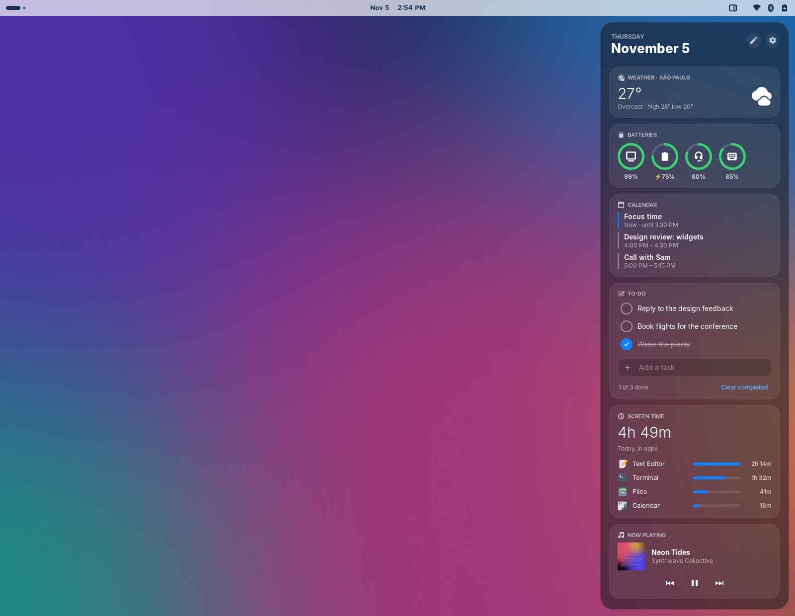
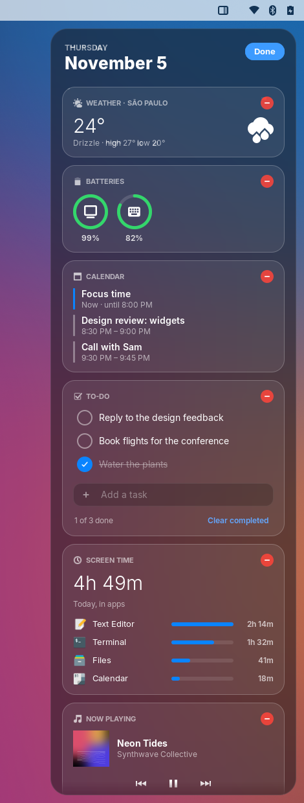
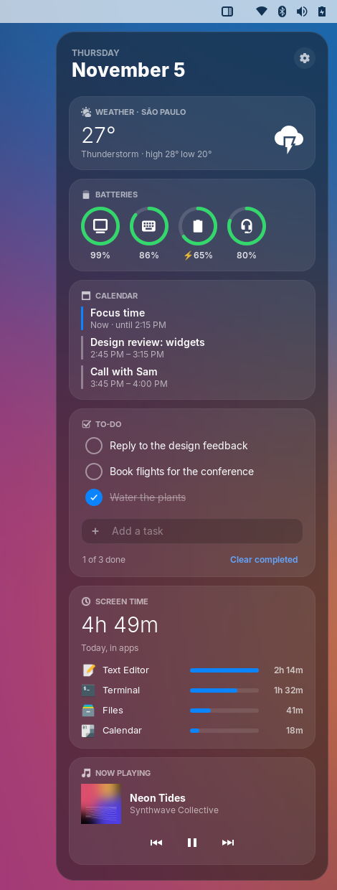
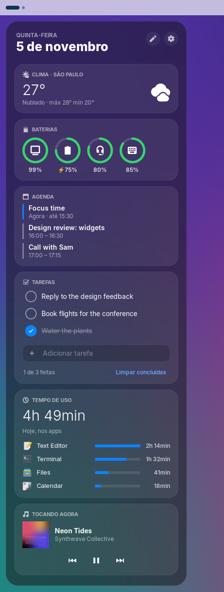
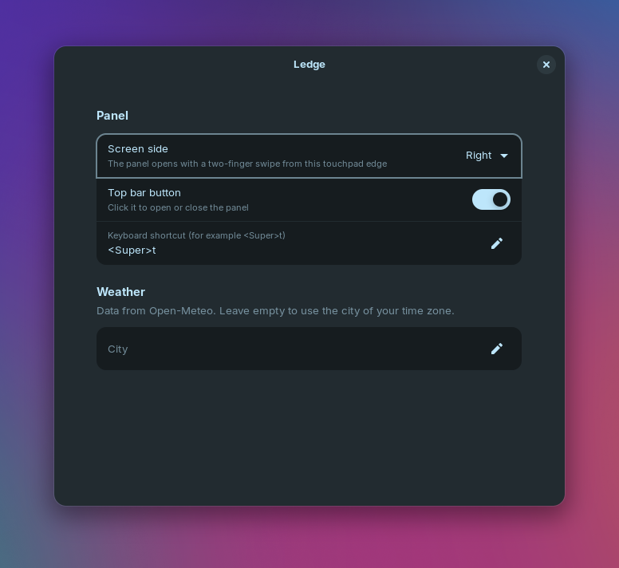
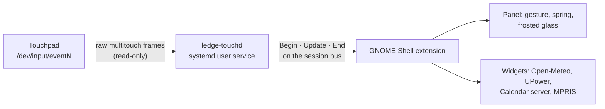

<div align="center">

# Ledge

**A Today View for GNOME.**<br>
Swipe two fingers in from the edge of your touchpad. Your day slides out.

[](https://github.com/GabrielGirardi/ledge/actions/workflows/ci.yml)
[](https://github.com/GabrielGirardi/ledge/releases)
[](#requirements)
[](LICENSE)



</div>

## Why Ledge

A glance at your day should take one gesture, not four apps. The weather
lives in one app, your headphone battery in a Settings page, your next meeting
in a calendar tab, and the song that is playing in a window somewhere behind
the others.

macOS and iOS solve this with a widget sidebar that is always one swipe away.
GNOME has nothing like it, and the two-finger edge swipe that makes it feel
natural is not even possible with the standard Linux input stack.

Ledge has three goals:

- **One glance.** It shows the few things you check all day, on one calm
  surface.
- **It feels physical.** The panel tracks your fingers 1:1 and settles with a
  spring. You flick it open; you never just click a button.
- **It feels at home in GNOME.** It is native GNOME Shell code. It reads the
  data your desktop already has, needs no accounts and no cloud, and leaves
  your desktop exactly as it was when you turn it off.

## See it move

<div align="center">

</div>

Swipe in from the touchpad edge and the panel follows your fingers. Let go
past halfway, or flick quickly, and a spring finishes the motion. Swipe back,
press <kbd>Esc</kbd>, or click anywhere outside the panel to close it.

No touchpad, or no visible bar? Push the pointer against the screen edge, press
<kbd>Super</kbd>+<kbd>T</kbd>, or click the Ledge button next to your system icons. The
panel opens on the screen you are using.

## What's inside

<table>
<tr>
<td width="50%" valign="top">

**☀️ Weather**<br>
Current conditions, with the daily high and low, for your city. Search for
it in the preferences, or let Ledge find it: where your device is, when
Location Services are on, otherwise the city of your time zone. The data
comes from
[Open-Meteo](https://open-meteo.com): free, no API key, no account.

**🔋 Batteries**<br>
One ring per device: your laptop, Bluetooth headphones, mouse, and keyboard.
A ring turns red when a battery is low.

</td>
<td width="50%" valign="top">

**📅 Calendar**<br>
What is left today, with the event happening now highlighted, or your first
event tomorrow. It reads the calendars you already connected in GNOME Online
Accounts.

**🎵 Now Playing**<br>
Cover art, title, artist, and playback controls for Spotify, browsers, and any
other player that supports MPRIS.

**✅ To-do**<br>
A quick list for today. Type a task and press <kbd>Enter</kbd>. Check it off
or delete it. The list stays on your machine.

**⏱️ Screen Time**<br>
How long you have used your apps today, in the last 7 days, or in the last
30, with your top four. Longer ranges show a daily average and one bar per
day. Idle and locked time are not counted.

</td>
</tr>
</table>

### Make it yours

Click the pencil in the panel's corner. Each card gets a red minus button. Drag a card
to move it, tap <kbd>−</kbd> to hide it, and bring it back from **Add widgets**.
On the keyboard, focus a card and press <kbd>↑</kbd> or <kbd>↓</kbd>. A hidden
widget is not loaded at all, so it costs nothing.

<div align="center">

</div>

<table>
<tr>
<td align="center" width="33%"><br><sub>Frosted glass over your wallpaper</sub></td>
<td align="center" width="33%"><br><sub>Either edge · English and Português</sub></td>
<td align="center" width="33%"><br><sub>A few preferences that matter</sub></td>
</tr>
</table>

## Install

> **Early preview (0.x).** Ledge is in daily use on the maintainer's machine,
> but expect rough edges, and expect settings to change between minor
> versions.

### Requirements

| | |
|---|---|
| GNOME Shell | 46. Versions 47 to 49 are on the roadmap. |
| Session | Wayland or X11 |
| Touchpad | Optional. The gesture needs a multitouch touchpad; the shortcut and the top bar button work without one. |
| Python | 3.10 or later, with PyGObject (`python3-gi`). Most GNOME systems already ship it. |

### From source

```sh
git clone https://github.com/GabrielGirardi/ledge.git
cd ledge
./scripts/install.sh
```

Then log out and log back in. On Wayland, GNOME Shell only discovers new
extensions at login.

The script installs three things:

1. The GNOME Shell extension, for your user only.
2. `ledge-touchd`, the touchpad helper, as a systemd user service.
3. A udev rule that lets your user read the touchpad. This step asks for
   `sudo` once.

To remove Ledge, run `./scripts/uninstall.sh`. Add `--udev` to also remove the
udev rule.

## Configure

Click the gear in the panel's top corner, run `gnome-extensions prefs
ledge@gabrielgirardi.github.io`, or open the Extensions app.

| Setting | Default | Notes |
|---|---|---|
| Screen side | Right | Only a swipe from this touchpad edge opens the panel. |
| Hot edge | On | Push the pointer against the screen edge to open the panel. Never fires in fullscreen apps or while dragging. |
| Panel button | On | Sits next to your system icons, wherever your bar is. |
| Widgets | All six | Choose and order them here, or with the pencil in the panel. |
| Keyboard shortcut | `<Super>t` | Any GTK accelerator, for example `<Super><Shift>d`. |
| Weather location | Automatic | Search for a city by name; results show the state and country. Automatic uses where your device is when Location Services are on (Settings › Privacy), otherwise the city of your time zone. |

Text follows your interface language. Dates and times follow your regional
format, even when the two differ.

## How it works

The standard Linux input stack reports every two-finger motion as scrolling,
without finger positions. So GNOME cannot tell an edge swipe apart from an
ordinary scroll. Ledge splits the work in two:



- **`ledge-touchd`** reads the touchpad's raw finger coordinates and decides
  whether a two-finger swipe started at an edge. It only reads the device,
  never grabs it, so scrolling keeps working everywhere.
- **The extension** moves the panel 1:1 with the swipe and settles it with a
  spring. While the panel is open, it holds input focus, so the window
  underneath does not scroll.

[docs/ARCHITECTURE.md](docs/ARCHITECTURE.md) has the D-Bus protocol, the gesture
state machine, and how the glass is rendered.

## Privacy

- **Touchpad only.** The udev rule matches `ID_INPUT_TOUCHPAD=1`. It never
  grants access to keyboards. The helper sends nothing over the network.
- **Weather only.** The weather widget sends a city name, and then its
  coordinates, to Open-Meteo. With automatic location and Location Services
  on, GNOME's location service (GeoClue) finds where you are, as it does for
  GNOME's own weather; Ledge names the nearest city from an offline list.
  Nothing else leaves your machine.
- **Local data.** Your to-do list and screen time are stored only in
  `~/.local/share/ledge/`, and only you can read them. Screen time keeps 30
  days of history. Delete the folder to erase it.
- **No telemetry.** Ledge has no analytics and no accounts.

## Troubleshooting

| Symptom | Check |
|---|---|
| The gesture does nothing | Run `systemctl --user status ledge-touchd`. If it says *no read access*, run `./scripts/install-udev-rule.sh`. |
| The panel never appears | Run `gnome-extensions info ledge@gabrielgirardi.github.io`. The state must be `ACTIVE`. |
| Something else | Run `journalctl --user -u ledge-touchd -b` and `journalctl -b /usr/bin/gnome-shell \| grep -i ledge`, then [open a bug report](https://github.com/GabrielGirardi/ledge/issues/new/choose). |

## Roadmap

- [x] Edge-swipe gesture, spring physics, frosted glass
- [x] Weather, batteries, calendar, to-do, screen time, and Now Playing widgets
- [x] Keyboard shortcut, panel button, settings button, left or right edge
- [x] English and Brazilian Portuguese
- [x] Opens on the active monitor
- [x] Hot edge, edit mode, and choosing and ordering widgets
- [x] UI regression tests on GNOME Shell, in CI
- [ ] **0.5:** GNOME Shell 47, 48, and 49
- [ ] **0.6:** more widgets: phone battery (GSConnect), system stats, world clocks, reminders
- [ ] **0.7:** extensions.gnome.org, AUR, Fedora COPR, `.deb`, and a Rust helper

The [milestones](https://github.com/GabrielGirardi/ledge/milestones) track the
details. Issues labeled [`good first
issue`](https://github.com/GabrielGirardi/ledge/labels/good%20first%20issue)
are a good place to start.

## Contributing

Code, translations, bug reports, and ideas are all welcome. Start with
[CONTRIBUTING.md](CONTRIBUTING.md). It covers the development setup (a nested
GNOME Shell, so you never need to log out), the commit convention, the code
style, and how releases work. Everyone taking part agrees to the [Code of
Conduct](CODE_OF_CONDUCT.md). To report a security issue, follow
[SECURITY.md](SECURITY.md).

The images in this README are generated by `tools/screenshots/run.sh` from
fictional data: the wallpaper, album art, calendar, and player are all
synthetic.

## License

Ledge is free software, licensed under the [GNU General Public License v3.0 or
later](LICENSE).
